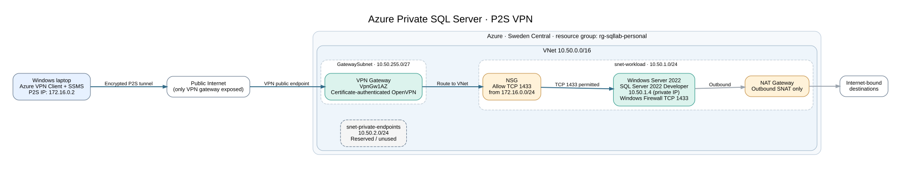

# Azure Private SQL Server Infrastructure with Point-to-Site VPN

**A reproducible Azure infrastructure lab deploying SQL Server 2022 on a private Windows VM, accessible from a remote Windows laptop only through certificate-authenticated Point-to-Site VPN.**

**Stack:** Microsoft Azure · Azure Bicep · Azure CLI · PowerShell · SQL Server 2022 · Windows Server 2022 · Azure VPN Gateway · SSMS

**Status:** Core lab deployed and validated on 13 October 2026. Production-hardening opportunities are documented separately.

Repository note: This repository contains the original Azure Bicep templates and PowerShell validation scripts. Private certificates, VPN client configurations and credentials are intentionally excluded.

## Why this project?

Publicly exposing a SQL Server VM to the internet is unnecessary for administrative access. This lab demonstrates a more restricted access pattern: deploy SQL Server **without a VM public IP**, route a certificate-authenticated remote client into an Azure VNet through a **Point-to-Site VPN**, and permit SQL Server's TCP port **1433** only from the VPN client address pool at the network and guest-firewall layers.

All core Azure infrastructure was provisioned using **Bicep** rather than point-and-click resource creation.

## Architecture



[Architecture details and address plan](docs/architecture.md) · [Editable Graphviz diagram](diagrams/architecture.dot)

### Verified components

| Component | Configuration |
|---|---|
| Azure region | Sweden Central |
| Resource group used for testing | `rg-sqllab-personal` |
| Virtual network | `vnet-sqllab-dev`, `10.50.0.0/16` |
| SQL workload subnet | `snet-workload`, `10.50.1.0/24` |
| Private endpoints subnet (reserved) | `snet-private-endpoints`, `10.50.2.0/24` |
| Gateway subnet | `GatewaySubnet`, `10.50.255.0/27` |
| SQL Server VM | `vm-sqllab-sql`, `Standard_D2as_v5`, Windows Server 2022 + SQL Server 2022 Developer |
| SQL VM address used during test | `10.50.1.4` (private; dynamically assigned) |
| VPN gateway | `vpngw-sqllab-dev`, `VpnGw1AZ` |
| P2S authentication | OpenVPN with trusted root and client certificate |
| VPN client address pool | `172.16.0.0/24` |
| Workload NSG | TCP 1433 inbound allowed from `172.16.0.0/24` |
| Windows Firewall | TCP 1433 inbound allowed from `172.16.0.0/24` |
| Egress | NAT Gateway on workload subnet with standard public IP |
| Database demo | `SqlLabDemo` with `dbo.Employees` |

The VPN Gateway has a public endpoint for clients to establish the tunnel; **the SQL Server VM has no public IP**. The NAT Gateway facilitates outbound connectivity, not inbound SQL access.

## What was validated

Tests were completed through **Azure VPN Client** and **SQL Server Management Studio** from the local laptop:

- [x] Network and VM Bicep deployments returned `Succeeded`.
- [x] VPN Gateway deployment returned `Succeeded`.
- [x] P2S client received `172.16.0.2` and a route for `10.50.0.0/16`.
- [x] `Test-NetConnection 10.50.1.4 -Port 1433` returned **`TcpTestSucceeded : True`**.
- [x] SQL Server (`MSSQLSERVER`) was running and listening on `0.0.0.0:1433`.
- [x] SSMS connected over the private address using Windows authentication.
- [x] The `vm-sqllab-sql\labadmin` login was verified as a `sysadmin` for this lab.
- [x] Database `SqlLabDemo` and `dbo.Employees` were created, with three sample records queried.
- [x] The SQL connection DMV returned `encrypt_option = TRUE`, `auth_scheme = NTLM`, `client_net_address = 172.16.0.2`.
- [x] The VM was deallocated following testing to stop VM compute charges.

Evidence: [SQL demo](evidence/sql-demo-results.png) · [Encrypted connection](evidence/encrypted-connection.png) · [Evidence details](evidence/README.md).

**Security caveat:** An encrypted SQL session does **not** by itself prove that the SQL Server certificate chain was validated. SSMS was tested with the **Trust Server Certificate** option; use a trusted certificate and least-privilege identities before production use.

## Project structure

```text
.
├── infra/                         # ORIGINAL Bicep templates (copy from local project)
│   ├── main.bicep
│   ├── sql-vm.bicep
│   └── vpn-gateway.bicep
├── scripts/                       # Original scripts + provided verification helper
|    |── verify-lab.ps1
|    ├── configure-sql-firewall.ps1
|    ├── diagnose-sql.ps1
├── sql/
│   └── 01-demo-database.sql
├── docs/
│   ├── architecture.md
│   ├── deployment.md
│   ├── security.md
│   ├── troubleshooting.md
│   └── cost-management.md
├── diagrams/
│   ├── architecture.dot
│   └── architecture.svg
├── evidence/
│   ├── sql-demo-results.png
│   └── encrypted-connection.png
├── .gitignore.recommended
└── README.md
```

## Quick start

1. Install [Azure CLI](https://learn.microsoft.com/en-us/cli/azure/install-azure-cli-windows), PowerShell and the Azure Bicep CLI (`az bicep install`).
2. Choose a subscription and region with sufficient permissions, VM SKU availability and quotas. **Avoid copying someone else's subscription ID.**
3. Generate and securely store the P2S certificate pair; only the **public root certificate data** is supplied to Azure.
4. Deploy the original network, VM and VPN Gateway Bicep templates in that order.
5. Import the newly generated VPN client profile into Azure VPN Client.
6. Configure SQL Server TCP/IP and the Windows Firewall, connect using an authorised Windows account, and run the demonstration SQL.
7. Verify SQL connectivity and encryption; deallocate the VM when no longer needed.

See the [full deployment runbook](docs/deployment.md). **This is not a free deployment:** NAT Gateway, VPN Gateway, public IPs and storage can incur ongoing charges.

## Key engineering lessons

- **IaC portability:** Reused the existing network, VM and VPN templates in a separate Azure subscription. The original D2as_v4 VM SKU was restricted in Sweden Central, so the VM template was adjusted to `Standard_D2as_v5`.
- **Troubleshooting by layer:** A connected VPN and correct route do not guarantee that SQL traffic can pass. The remaining connectivity problem was resolved by applying the Windows Firewall allow rule on the new SQL VM.
- **Authentication and transport are different controls:** A successful TCP handshake did not grant SQL access. SSMS used Windows authentication with an authorised local SQL administrator.
- **Verify the security outcome:** Queried SQL Server's connection DMV to confirm transport encryption and client VPN address.
- **Cost awareness:** Deallocated compute after testing while recognising that gateways, public IPs and disks may still be billable.

## Documentation and limitations

- [Architecture and traffic flow](docs/architecture.md)
- [Deployment and verification](docs/deployment.md)
- [Security posture and gaps](docs/security.md)
- [Troubleshooting log](docs/troubleshooting.md)
- [Cost management and teardown](docs/cost-management.md)
- [Evidence](evidence/README.md)

This is a **demonstrated development lab**, not a production HA/DR solution. It does not claim automated database backups, full CA-validated TLS, a least-privilege application account, monitoring/alerting or a tested CI/CD deployment pipeline.
